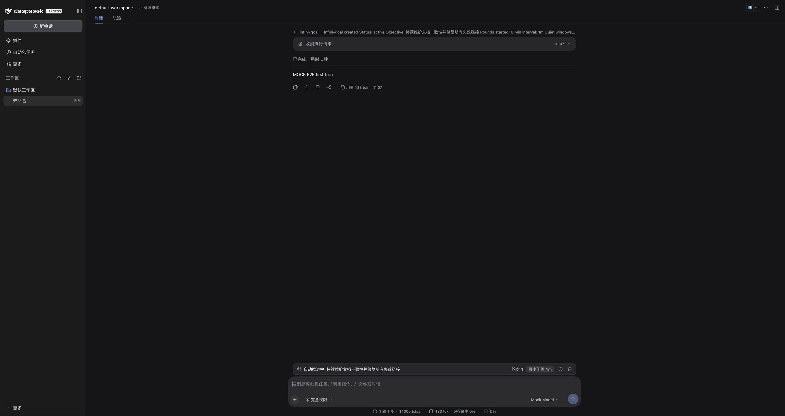
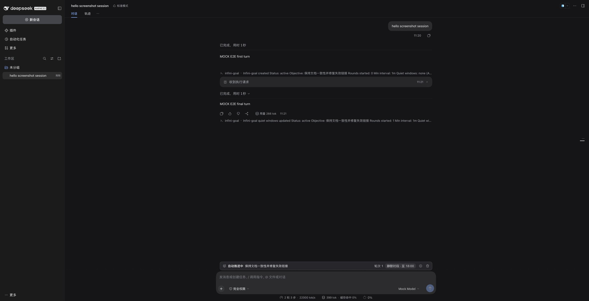

# dsh-infini-goal

English | [简体中文](https://github.com/yankeguo/dsh-infini-goal/blob/main/README.zh.md)

A plugin suite for [DeepSeek Harness](https://github.com/deepseek-ai/deepseek-harness) (DSH) that
turns automatic continuation into an **endless goal**: a goal keeps running with **no round cap**,
paced by a **minimum trigger interval**, and held back by configurable **quiet windows** for
do-not-disturb, focus time, off-hours, nights — or anything else you choose.

- **No maximum rounds**: a goal stays `active` until it is completed, paused, blocked, or cleared.
- **Minimum trigger interval**: two automatic rounds start at least the configured interval apart
  (default 1 minute, from 1 second to 30 days), so an empty loop cannot spin into rapid retries.
- **Quiet windows**: no automatic rounds inside the configured local-time ranges; human
  conversation and tool calls keep working as usual, and automatic progress resumes when the window
  ends.
- **Built-in goal off by default**: installing the bundle also switches DSH's official `dsh-goal`
  off as one ordinary bundle layer, so infini-goal is the only goal system without installing a
  second bundle. Every row it contributes stays switchable on the Plugins page.

## Features

| Capability | Description |
| --- | --- |
| Endless continuation | No round cap; a goal can run indefinitely until you stop it |
| Minimum trigger interval | Each automatic round starts at least the configured duration after the previous one |
| Quiet windows | Midnight crossing, ISO weekday filters, and IANA time zones; no automatic rounds inside a window |
| Durable goals | Goals survive app restarts and session restores; pause/resume/complete/block are persisted as session records |
| Model tools | `get_infini_goal` / `create_infini_goal` / `update_infini_goal` |
| Human command | `/infini-goal` — inspect status, configure pacing, pause/resume without spending model rounds |
| Status bar | InfiniGoalBar above the composer: phase, rounds, trigger pacing, quiet-window hint, pause/resume/clear |
| Careful authorization | Creating or rewriting a goal needs human (or delegated DevLead relay) authority; the model cannot do it on its own |
| Coexistence | Tool, command, and status-bar names do not collide with the official `dsh-goal`; the bundle switches the official goal off by default |

## How it differs from the official dsh-goal

| Dimension | Official `dsh-goal` | This plugin |
| --- | --- | --- |
| Round cap | `maxGoalRounds` (default 256) | No cap |
| Trigger throttling | None; resumes immediately when idle | Minimum trigger interval + quiet windows |
| Activation | In-process `armed`/`disarmed`; manual resume after restore or fork | Durable `phase`: continues after an app restart or session restore (set `autoContinueOnStart: false` to persist goals as paused at startup) |
| Tools / commands | `get_goal` / `create_goal` / `update_goal`, `/goal` | `*_infini_goal`, `/infini-goal` |
| Coexistence | — | Different names; the bundle switches the official goal off by default and can switch it back live |

## Requirements

| Item | Requirement |
| --- | --- |
| DSH | `>=0.2.2-rc.1 <0.3.0` (the 0.2.2 release line). DSH skips a bundle whose declared `engines.dsh` does not match; see [DSH compatibility](https://github.com/yankeguo/dsh-infini-goal/blob/main/docs/COMPATIBILITY.md) for the verified matrix |
| DSH surface | A DSH profile (desktop app or `dsh web`). The status bar only renders in the Web UI |
| Dependencies | None beyond DSH for normal use: one npm bundle installs all eight suite packages. No extra API keys — automatic rounds use the model already configured in DSH |
| Node.js | Not needed to install from npm. Node.js ≥ 24.9 and pnpm 12 are only needed for the optional 0.1.0 session-repair script or a local checkout ([contributing](https://github.com/yankeguo/dsh-infini-goal/blob/main/docs/CONTRIBUTING.md)) |
| Permissions | Installed as an ordinary DSH bundle. Like any third-party plugin it runs in the host process (installing it means trusting its code), does not change DSH's sandbox or permission mode, and adds no privilege-escalation path |

## Installation

### Install from npm (recommended)

```sh
# Main bundle: core service + driver + model tools + command + status bar.
# It also switches the built-in dsh-goal mode off by default.
dsh plugin --profile desktop add @yankeguo/dsh-infini-goal-bundle
```

One bundle is enough: it embeds the same built-in-goal disable layer as the standalone
`@yankeguo/dsh-disable-goal-bundle`, so you do not need to install that companion bundle. You can
also install from the Web UI: **Plugins → Add plugin**, then enter the package name.

After installing, confirm on the **Plugins** page that the bundle is enabled (newly installed
bundles are usually enabled by default; if it shows as disabled, tick it), then refresh the Web
page. On the bundle's page every row it contributes (the five infini-goal rows and the three
generated preset-filter rows) can be switched individually — for example, keep the suite but hide
the status bar. Switching the whole bundle off restores the official goal mode live.

For advanced setups you can also install individual plugin packages and insert their loader rows
into the profile's `cordis.patch.yml` yourself; for everyday use, install the main bundle.

Installing this bundle also disables DSH's built-in `dsh-goal` mode by default, so `/goal` and the
official goal tools disappear. The rationale and maintenance details are in
[Disabling the built-in dsh-goal](https://github.com/yankeguo/dsh-infini-goal/blob/main/docs/DISABLE-BUILTIN-GOAL.md).

### Upgrade

```sh
# Install a specific version explicitly to upgrade deliberately
dsh plugin --profile desktop add @yankeguo/dsh-infini-goal-bundle@<version>
```

Release notes for every version are in
[docs/releases](https://github.com/yankeguo/dsh-infini-goal/tree/main/docs/releases) and on
[GitHub Releases](https://github.com/yankeguo/dsh-infini-goal/releases).

### Uninstall

```sh
# DSH clears the selection of removed bundles the next time it loads the profile
dsh plugin --profile desktop remove @yankeguo/dsh-infini-goal-bundle

# Only if you installed the companion bundle separately
dsh plugin --profile desktop remove @yankeguo/dsh-disable-goal-bundle
```

### Companion bundle

`@yankeguo/dsh-disable-goal-bundle` exists for profiles that want the built-in goal off
**without** the infini-goal suite; the main bundle already embeds the same layer. Do not enable
both bundles in one profile: they share the same row ids on purpose, so DSH tolerates the duplicate
rows and mounts the filters once, but the Plugins page can then no longer switch those three
filter rows individually. Prefer one bundle.

When upgrading from a release whose main bundle did not yet embed the disable layer: if the profile
still selects `@yankeguo/dsh-disable-goal-bundle`, disable or remove that bundle on the Plugins
page (a local checkout can rerun `pnpm install:profile`, which deselects it).

### Upgrading from 0.1.0 / repairing old sessions

0.1.0 wrote goal changes as a custom Session event. DSH 0.2.2-rc.1's durable reader only accepts
event types from its own vocabulary (or plugin records marked `ignorable`), so a **Session whose
goals were written by 0.1.0 is refused interpretation after a restart** (it reports "refusing to
interpret the log — it was likely written by a newer harness"). Current versions store changes as
ignorable plugin records but **do not migrate** old 0.1.0 logs automatically; when needed, repair
them once with the repository script. The tool ships with the repository rather than with the npm
packages, so clone the repository and run `pnpm install` there first, then:

```sh
# Quit every DSH instance that could write these Sessions first; dry-run is the default and only prints a report
node scripts/repair-session-log.mjs --dry-run --dsh-home ~/.dsh

# After confirming the report (e.g. "DRY-RUN ... rewrote 7 row(s)"), write the result
node scripts/repair-session-log.mjs --write --dsh-home ~/.dsh
```

The script only rewrites the old goal-change rows into ignorable plugin records; all other rows and
bytes stay untouched. It keeps a timestamped `*.bak-repair-*` backup before writing, refuses by
default to repair Sessions still holding a `session.lock` (add `--force` once the owning process
has exited), is idempotent, and can also target individual logs with
`--write <session-dir|log-file>...`. It requires Node.js ≥ 24.9 and a completed `pnpm install` in
this repository.

## Usage

```
/infini-goal Fix all failing doc checks and keep CI green   # create a goal
/infini-goal                                          # show status and the next trigger time
/infini-goal status                                   # explicit alias of the previous form
/infini-goal interval 10m                             # change the minimum trigger interval to 10 minutes
/infini-goal quiet "Mo-Fr 09:00-18:00"                # example: no automatic triggers in that window
/infini-goal quiet none                               # clear the quiet windows
/infini-goal timezone Asia/Shanghai                   # set the quiet-window time zone (system = host zone)
/infini-goal pause | resume | complete | clear
/infini-goal block vendor quota exhausted             # mark the goal blocked
/infini-goal edit <new objective>
```

You can also let the model create a goal: when a human request is a long-running objective, the
model calls `create_infini_goal` (this requires a direct human message or a shape-valid DevLead
relay prompt in the current round). After a goal is `complete`, running
`/infini-goal edit <new objective>` creates a new goal instead of modifying the completed one.
Command arguments support paired quotes (e.g. the quotes around `"Mo-Fr 09:00-18:00"` are stripped
and never become part of the value); `interval` / `quiet` / `timezone` are rejected while the goal
is `complete` — create a new goal first.

## Status bar

The status bar sits above the composer, in the same slot as the official goal's GoalBar:

| Auto-continuing (rounds and pacing) | Quiet window (no automatic trigger) |
| --- | --- |
|  |  |

| Goal state | Status bar shows | Buttons |
| --- | --- | --- |
| `active`, minimum interval elapsed since the last round | Auto-continuing · objective · Rounds: N · `next round in mm:ss` (refreshed every second) | Pause / Clear |
| `active`, minimum interval not reached yet | Auto-continuing · objective · Rounds: N · `min interval 1m` | Pause / Clear |
| `active`, inside a quiet window | Auto-continuing · objective · Rounds: N · `quiet window · until HH:mm` | Pause / Clear |
| `paused` / `blocked` | Paused / Blocked (blocked also shows the reason) · Rounds: N; no pacing row | Resume / Clear |
| `complete` or no goal | Nothing rendered | — |

The buttons only dispatch `/infini-goal ...` commands; no custom Remote API is involved. Command
errors are shown inline in the status bar.

## Configuration

Deployment-level configuration goes into the profile patch row that loads the plugin. The bundle
ships defaults; to change them, override `config` in the profile's `cordis.patch.yml` by loader row
id — note that DSH patches replace the row's config wholesale.

### Deployment defaults (core service)

```yaml
- id: infini-goal
  name: '@yankeguo/dsh-infini-goal'
  config:
    defaultMinIntervalMs: 60000        # default minimum trigger interval
    defaultQuietWindows: []            # default quiet windows; elements are { days: [1..7], start: 'HH:mm', end: 'HH:mm' or '24:00' }
    # timezone: Asia/Shanghai          # optional override; the default is the host system zone
```

| Key | Default | Range / notes |
| --- | --- | --- |
| `defaultMinIntervalMs` | `60000` | `1000` – `2592000000` (1s – 30d), integer milliseconds |
| `defaultQuietWindows` | `[]` | each element is `{ days, start, end }`; syntax and schedulability are validated at creation time |
| `timezone` | host system zone | IANA name; defaults to the system zone resolved via `Intl` |

### Driver

```yaml
- id: infini-goal-driver
  name: '@yankeguo/dsh-infini-goal-driver'
  config:
    autoContinueOnStart: true          # whether to auto-continue active goals when the plugin loads / the agent is created
    pollFloorMs: 1000                  # safety polling interval while the agent is busy or competing input exists
```

| Key | Default | Notes |
| --- | --- | --- |
| `autoContinueOnStart` | `true` | when `false`, existing `active` goals are durably paused at startup (a pause event is written) and wait for a human `/infini-goal resume` |
| `pollFloorMs` | `1000` | integer, minimum `100`; retry interval while the agent cannot be driven |

### Model-tool policy

```yaml
- id: infini-goal-tool
  name: '@yankeguo/dsh-tool-infini-goal'
  config:
    blockedAfterConsecutiveRounds: 3   # minimum rounds before the model may report blocked in automatic rounds
```

| Key | Default | Notes |
| --- | --- | --- |
| `blockedAfterConsecutiveRounds` | `3` | positive integer; applies only when the goal's own automatic round reports `blocked` — human/DevLead-relay authorization is not limited by it |

The bundle's tool row does not set this option explicitly, which is equivalent to the default `3`.

### Per-goal overrides

`create_infini_goal` / `/infini-goal interval` / `/infini-goal quiet` / `/infini-goal timezone`
write each goal's own durable settings, which take precedence over deployment defaults; the
`/infini-goal` status output and the status bar also display the per-goal settings.

### Duration and quiet-window syntax

- **Durations**: `500ms`, `90s`, `5m`, `1h30m`, `2d`, composable; as a minimum trigger interval it
  must be between `1s` and `30d`.
- **Quiet windows**: semicolon-separated; each entry is `[days ]HH:mm-HH:mm`, e.g.
  `Mo-Fr 09:00-18:00; Sa-Su 10:00-12:00; 22:00-06:00`.
  - empty `days` = every day; ISO weekdays 1=Monday … 7=Sunday, supporting `Mo-Fr`, `Sa,Su`, `1-5`;
    `daily` / `everyday` / `*` all mean every day;
  - a window's `start` is included and `end` excluded; `end < start` means crossing midnight (e.g.
    `22:00-06:00`); `start == end` is rejected. `end` may be `24:00`, the exclusive end of the
    start day (next local midnight), while `start` stays within `00:00-23:59`; because a legacy
    `end` of `23:59` would leave the 23:59 minute uncovered, it is normalized to `24:00` (an
    existing `Fr 18:00-23:59; Sa 00:00-23:59` becomes `Fr 18:00-24:00; Sa 00:00-24:00`).
    `00:00-24:00` is the explicit full-day form;
  - `days` filters the **starting day** of the window, e.g. `Sa-Su 22:00-06:00` covers Saturday
    22:00→Sunday 06:00 and Sunday 22:00→Monday 06:00;
  - multiple windows form a union; the time zone comes from `timezone`, and windows advance by local
    wall-clock time across DST transitions;
  - `none` / `off` / empty text means no quiet windows; `always` / `all` are rejected;
  - a configuration whose windows cover all local time (automatic rounds could never trigger) is
    rejected.

## Behavior

- **Pacing**: `nextAt = max(now, lastRoundAt + minIntervalMs)` (the first round is not limited by
  the interval; it triggers as soon as the agent is idle and no quiet window applies); if the
  target falls inside a quiet window, it is pushed to the end of that window (possibly repeatedly)
  until it no longer falls inside any window. The countdown in the status bar is computed locally,
  so a second-level display drift is possible; the actual trigger is computed by the driver from the
  same schedule.
- **Empty loops**: every round is a normal turn; rounds are spaced by the minimum trigger interval,
  so a "reply-then-trigger-immediately" burst cannot occur.
- **Humans first**: human messages and other tool calls proceed as usual; when competing input
  exists the driver yields and injects the next round only once the agent is idle and pacing
  allows.
- **Quiet time only gates automatic triggers**: `/infini-goal` status, human conversation, and tool
  calls are unaffected.
- **Durable**: goal progress is written to disk before each automatic round, so a restarted or
  restored session continues from up-to-date history; goals continue after a restart or restore
  unless `autoContinueOnStart: false` is set.

### Failed automatic rounds

A failed automatic round marks the goal `blocked`; `blockedReason.code` is one of:

| code | Trigger condition |
| --- | --- |
| `max-tokens` | the automatic round hit the output token limit |
| `turn-error` | the turn ended in error |
| `agent-error` | the agent reported an error during the automatic round |
| `queue-failed` | the round message could not be queued |
| `driver-error` | internal driver exception |
| `prompt-rejected` | the round message was rejected by a downstream hook before entering a step |
| `checkpoint-failed` | flushing the Session log before injecting the next round failed (durability checkpoint) |

`agent-error` is usually the code actually recorded for a failed round (`agent/error` arrives before
`turn/end`, and both belong to that round's own turn). A human / hook interrupt or cancellation of
**the round's own turn** pauses the goal instead; host-command pause/complete/block/clear only abort
the running automatic round and do not affect human turns. `/infini-goal resume` on a blocked goal
clears `blockedReason`.

## Known limitations

- **Single goal**: each Session has exactly one infini-goal at a time.
- **Resume means continue**: `active` is durable, so the goal continues after a DSH restart or a
  session restore; with `autoContinueOnStart: false` the driver durably pauses active goals at
  startup / agent creation, and a human must run `/infini-goal resume`.
- **Forks continue too**: a forked child session contains the goal history and keeps advancing by
  default; pause first if you do not want that.
- **Costs model rounds**: every automatic round is a normal turn, so a long-running goal spends
  model tokens; use the minimum interval, quiet windows, and pause to control it.
- **The countdown is computed locally**: the status bar computes the countdown from the current
  goal state with a local per-second timer, so second-level display drift is possible.
- **Compatibility**: the plugins / bundles declare `engines.dsh: >=0.2.2-rc.1 <0.3.0`; they must be
  updated before DSH moves to 0.3. See [DSH compatibility](https://github.com/yankeguo/dsh-infini-goal/blob/main/docs/COMPATIBILITY.md).
- **Single-session semantics**: goals and rounds belong to the current Session; there is no
  cross-session sharing or aggregation of goals.

## Authorization and safety

Goal changes come from a human, the current goal's automatic round, or the explicit DevLead relay
trust exception; the model cannot create or rewrite a goal on its own judgment:

- **Humans**: `/infini-goal ...` commands can create, edit, pause, resume, complete, block, and
  clear goals, and configure pacing via `interval` / `quiet` / `timezone`.
- **Model tools**: `create_infini_goal`, and `edit` / `config` / `resume` on
  `update_infini_goal`, require a direct human message or a shape-valid DevLead relay prompt in the
  current turn. `pause`, `complete`, and `blocked` are additionally allowed for the current goal's
  own automatic round (pause only stops autonomy); reporting `blocked` from an automatic round
  also requires `blockedAfterConsecutiveRounds` (default 3).
- **Not human authority**: DevLead notices, scheduled prompts, subagent messages, agent-team
  messages, other agent messages, and runtime notices never authorize a goal change.
- **UI**: status-bar buttons only submit `/infini-goal ...` commands; there is no independent Remote
  API or higher privilege.
- **Security boundary**: the plugin runs inside the host process, so installing a third-party
  plugin is equivalent to trusting its code; this suite does not change DSH's sandbox / permission
  mode, nor does it provide any privilege-escalation entry point.

The exact relay shape, the fail-closed rules, and the full authorization model are documented in
[Design notes](https://github.com/yankeguo/dsh-infini-goal/blob/main/docs/DESIGN.md).

## Troubleshooting / FAQ

| Symptom | Likely cause / action |
| --- | --- |
| No status bar after installing | the bundle is not enabled (tick it on the Plugins page) or the page was not refreshed |
| No `/infini-goal` command or `*_infini_goal` tools | the bundle is not enabled / was skipped by DSH (check the DSH version and `engines.dsh`) |
| The goal does not continue automatically | phase is not `active`; a quiet window applies or the minimum interval has not elapsed; the goal was durably paused under `autoContinueOnStart: false`; the agent is busy or competing input exists |
| `/infini-goal quiet ...` reports a "covers all day"-style error | the union of quiet windows covers all local time, which would block automatic rounds forever; use partial windows or `none` |
| The status bar shows paused and does not resume automatically | expected under `autoContinueOnStart: false`; run `/infini-goal resume` |
| The goal keeps running after a fork | expected; run `/infini-goal pause` before forking |
| A Session cannot be restored after a restart; the log reports "refusing to interpret the log" | that Session was written with the old 0.1.0 representation; quit DSH and run the repair script described under "Upgrading from 0.1.0 / repairing old sessions" above |
| `repair-session-log.mjs` reports session.lock | the Session is still open in DSH; quit DSH / close the Session and retry, or add `--force` once the owning process has exited |
| `/goal` still appears | the bundle switches the official goal off by default, and preset changes only affect new agents: restart DSH and create a new session once. If the bundle or one of its preset-filter rows was disabled on the Plugins page, re-enable it |
| I want the official goal mode back | disable the `@yankeguo/dsh-infini-goal-bundle` bundle on the Plugins page (or remove it); the official goal returns live |
| Does an endless goal cost model tokens? | yes: every automatic round is a normal model turn; tune the minimum interval / quiet windows, or pause the goal when you do not need it |

## Documentation

- [Design notes](https://github.com/yankeguo/dsh-infini-goal/blob/main/docs/DESIGN.md) — domain
  model, persistence, driver, authorization, and UI design
- [DSH compatibility](https://github.com/yankeguo/dsh-infini-goal/blob/main/docs/COMPATIBILITY.md) —
  declared range, verified matrix, compatibility shims
- [Disabling the built-in dsh-goal](https://github.com/yankeguo/dsh-infini-goal/blob/main/docs/DISABLE-BUILTIN-GOAL.md) —
  why and how the official goal is switched off
- [Contributing and development](https://github.com/yankeguo/dsh-infini-goal/blob/main/docs/CONTRIBUTING.md) —
  repository layout, build/test commands, E2E harness, plugin metadata
- [Release and publishing guide](https://github.com/yankeguo/dsh-infini-goal/blob/main/docs/PUBLISHING.md) —
  staged publishing runbook
- [Release notes](https://github.com/yankeguo/dsh-infini-goal/tree/main/docs/releases) and
  [GitHub Releases](https://github.com/yankeguo/dsh-infini-goal/releases) — version history and
  changelogs
- [E2E harness](https://github.com/yankeguo/dsh-infini-goal/blob/main/tools/e2e/README.md) —
  development-only isolated verification tooling

## License

[MIT](https://github.com/yankeguo/dsh-infini-goal/blob/main/LICENSE)
