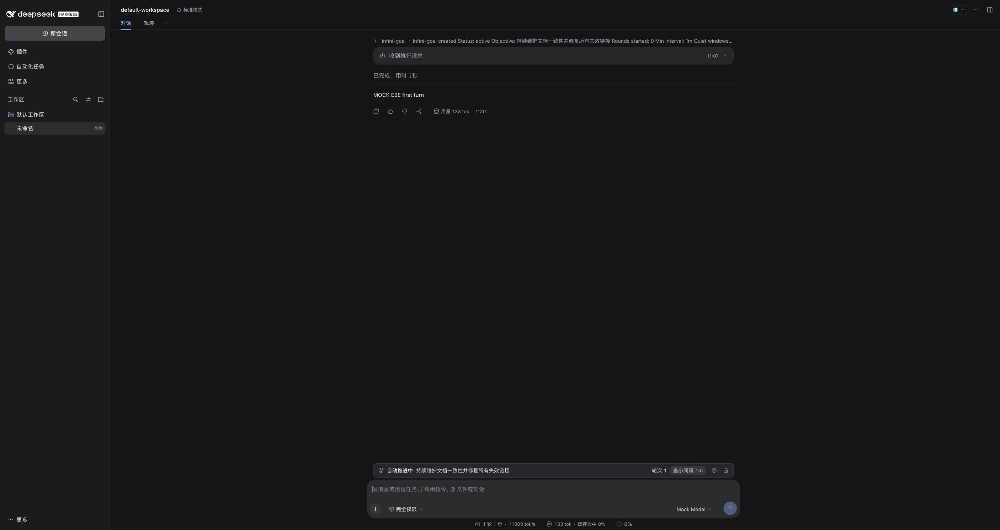
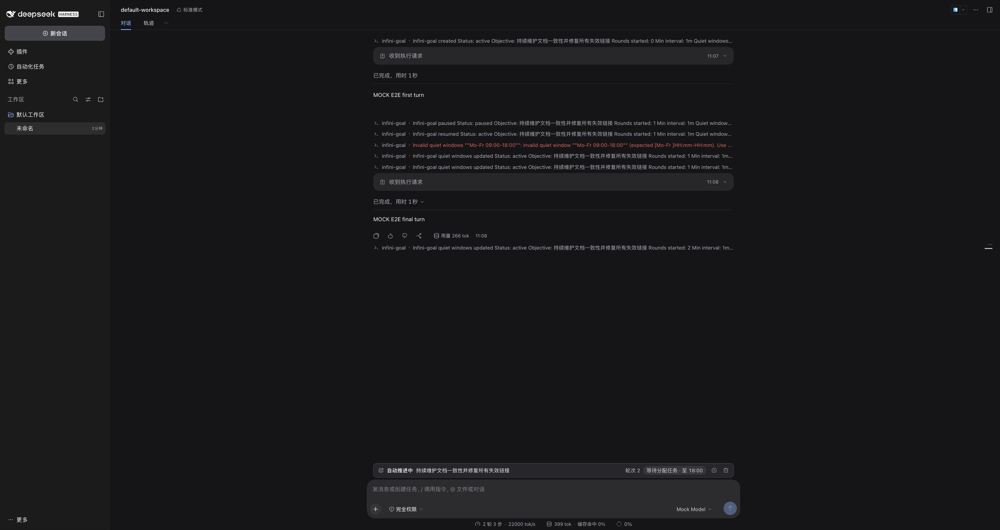

# dsh-infini-goal

一套面向 [DeepSeek Harness](https://github.com/deepseek-ai/deepseek-harness)（DSH）的插件：
参考官方 `dsh-goal` 的领域模型、模型工具与 UI 形态，但把"自动续跑"改造成一个
**无限轮次的员工式目标**。

- **没有最大轮次**：目标保持 `active` 直到被完成、暂停、阻塞或清除；
- **最小触发间隔**：两次自动轮次的开始时间至少相隔 `minIntervalMs`，空循环不会疯狂重试；
- **静默时段**（`quietWindows`）：配置的本地时间段内绝不自动触发，模拟员工上班时间
  "等着被分配任务"；人类对话与工具调用照常工作，时段结束后自动继续。

## 特性

| 能力 | 说明 |
| --- | --- |
| 无限续跑 | 无 `maxGoalRounds`；`roundsStarted` 只增不减，可以一直跑下去 |
| 最小触发间隔 | 每轮自动触发至少间隔可配置时长（默认 1 分钟，最小 1 秒），专门抑制空循环 |
| 静默时段 | 支持跨午夜、按 ISO 星期过滤、IANA 时区；时段内不触发自动轮次 |
| 事件溯源 | 所有变更写入 Session 日志（`infini-goal/change`），严格回放校验，可 resume / fork |
| Session projection | `infiniGoal` projection 把当前目标同步到浏览器，UI 无需自定义 Remote API |
| 模型工具 | `get_infini_goal` / `create_infini_goal` / `update_infini_goal` |
| 人类命令 | `/infini-goal`，可在不消耗模型轮次的情况下查看状态、配置节奏、暂停/恢复 |
| 状态条 UI | composer 上方的 InfiniGoalBar：阶段、轮次、下一轮倒计时、静默等待提示、暂停/恢复/清除 |

## 界面

状态条固定在 composer 上方，与官方 goal 的 GoalBar 同槽位（`conversation.input.dock`）：

| 自动推进中（显示轮次与节奏） | 静默时段（上班等待派活） |
| --- | --- |
|  |  |

## 与官方 dsh-goal 的差异

| 维度 | 官方 `dsh-goal` | 本插件 |
| --- | --- | --- |
| 轮次上限 | `maxGoalRounds`（默认 256） | 无上限 |
| 触发节流 | 无，空闲立即续跑 | 最小触发间隔 + 静默时段 |
| 激活模型 | 进程内 `armed`/`disarmed`，恢复/派生后需人工 resume | 持久化 `phase`：应用重启、会话恢复后继续（可配置 `autoContinueOnStart: false`） |
| 工具/命令 | `get_goal` / `create_goal` / `update_goal`，`/goal` | `*_infini_goal`，`/infini-goal`，可与官方 goal 共存 |
| 远程 API | Typert Remote | 不需要：UI 读 Session projection，操作经 `/infini-goal` 命令 |

## 包结构

```
packages/
  protocol/    @yankeguo/dsh-infini-goal-protocol   纯类型 + 间隔/时区/静默时段数学（host 与浏览器共用）
  infini-goal/ @yankeguo/dsh-infini-goal            核心服务 ctx.infiniGoals + 严格回放 fold + projection
  driver/      @yankeguo/dsh-infini-goal-driver     自动续跑驱动器（最小间隔 / 静默时段）
  tool/        @yankeguo/dsh-tool-infini-goal       模型工具
  command/     @yankeguo/dsh-command-infini-goal    /infini-goal 人类命令
  client-ui/   @yankeguo/dsh-client-ui-infini-goal  浏览器状态条
  bundle/      @yankeguo/dsh-infini-goal-bundle     bundle：cordis.patch.yml + 依赖
```

构建产物为每个包的 `lib/index.js`（浏览器包另有 `lib/client.js`）。构建用 esbuild：
host 入口只把 `@deepseek-ai/*` 保持为外部依赖，工作区包内联，产物自包含。

## 快速开始

### 1. 构建

```sh
pnpm install
pnpm build
```

### 2. 安装到 DSH profile

本地 checkout 场景，把插件链接进 profile 并启用 bundle：

```sh
pnpm install:profile                  # 默认 --profile desktop
# 或指定 profile / home
node scripts/install-profile.mjs --profile desktop --dsh-home ~/.dsh
```

脚本做两件事：

1. 把 6 个包符号链接到 `$DSH_HOME/profiles/<profile>/node_modules/@yankeguo/`；
2. 把 `@yankeguo/dsh-infini-goal-bundle` 追加进 profile 的 `dsh.profile.bundles`。

写入前会备份 profile `package.json`。DSH 的 profile HMR 会实时加载 Host 插件；
浏览器侧刷新页面后出现状态条。卸载：`pnpm uninstall:profile`。

> 发布到 npm 后可改为：`dsh plugin --profile desktop add @yankeguo/dsh-infini-goal-bundle`。

### 3. 使用

```
/infini-goal 修完所有 failed 的文档校验并保持 CI 绿色   # 创建目标
/infini-goal                                          # 查看状态与下一次触发时间
/infini-goal interval 10m                             # 最小触发间隔改成 10 分钟
/infini-goal quiet "Mo-Fr 09:00-18:00"                # 工作时间不自动触发（等待派活）
/infini-goal quiet none                               # 取消静默时段
/infini-goal timezone Asia/Shanghai                   # 设置静默时段时区（system 用本机时区）
/infini-goal pause | resume | complete | clear
/infini-goal block 供应商配额耗尽                       # 标记阻塞
/infini-goal edit <新目标>
```

也可以直接让模型创建目标——工具 `create_infini_goal` 会在人类请求是长期目标时被调用。

## 配置

### 部署默认值（核心服务）

```yaml
- id: infini-goal
  name: '@yankeguo/dsh-infini-goal'
  config:
    defaultMinIntervalMs: 60000        # 默认最小触发间隔（1s ~ 30d）
    defaultQuietWindows: []            # 默认静默时段，元素 { days: [1..7], start: 'HH:mm', end: 'HH:mm' }
    timezone: Asia/Shanghai            # 默认静默时区；缺省取宿主系统时区
```

### 驱动器

```yaml
- id: infini-goal-driver
  name: '@yankeguo/dsh-infini-goal-driver'
  config:
    autoContinueOnStart: true          # 插件加载/会话恢复时是否自动继续 active 目标
    pollFloorMs: 1000                  # agent 暂不空闲时的安全轮询间隔
```

### 目标级覆盖

`create_infini_goal` / `/infini-goal interval` / `/infini-goal quiet` / `/infini-goal timezone`
写入的是每个目标自己的持久化设置，优先于部署默认值。

### 语法

- **时长**：`500ms`、`90s`、`5m`、`1h30m`、`2d`；最小 1s，最大 30d。
- **静默时段**：分号分隔多条，每条 `[days ]HH:mm-HH:mm`，例如
  `Mo-Fr 09:00-18:00; Sa-Su 10:00-12:00; 22:00-06:00`。
  - `days` 为空 = 每天；ISO 星期 1=周一 … 7=周日，支持 `Mo-Fr`、`Sa,Su`、`1-5`；
  - `end <= start` 表示跨午夜（如 `22:00-06:00`）；
  - 时区由 `timezone` 决定，跨夏令时时按本地墙钟时间推进；
  - 若静默时段覆盖全天（永远无法触发），配置会被拒绝。

## 行为细节

- **节奏**：`nextAt = max(now, lastRoundAt + minIntervalMs)`；若落在静默时段内，则推进到
  该时段结束（可连续推进），直到不落在任何静默时段。
- **空循环**：每轮都是一次正常 turn；轮次间隔由最小触发间隔保证，不会出现"秒回秒触发"。
- **人类优先**：人类消息、其它工具调用照常进行；有竞争输入时驱动器会让路，等 agent 空闲
  且节奏满足后再注入下一轮。
- **失败处理**：自动轮次遇到 `max-tokens` / turn error / agent error / 队列失败会
  `block`（code 分别为 `max-tokens` / `turn-error` / `agent-error` / `queue-failed`）；
  人类打断正在运行的自动轮次会 `pause`，等待下一步指令。
- **静默时间只限制自动触发**：`/infini-goal` 状态、人类对话、工具调用不受影响。

## 已知限制

- **单目标**：每个 Session 同时只有一个 infini-goal。
- **恢复即续跑**：`active` 是持久化状态，DSH 重启或会话恢复后会继续（可设
  `autoContinueOnStart: false` 改为等待人工 resume；此时 UI 的状态条仍显示 active 倒计时，
  属于已知显示局限）。
- **fork 也会续跑**：fork 出的子会话包含目标历史，默认继续推进；不需要时先 `pause` 再 fork。
- **UI 操作经命令**：状态条按钮发送 `/infini-goal ...` 命令，不引入自定义 Typert Remote。
- **兼容性**：`engines.dsh` 约束为 `>=0.2.2-rc.1 <0.3.0`；DSH 升级到 0.3 前需要更新插件。

## 开发与验证

```sh
pnpm typecheck     # 全仓 TS 检查
pnpm test          # 协议数学 / fold / 工具与命令解析等单测
pnpm build         # esbuild 产物
pnpm dev:patch     # 生成 .tmp/cordis.patch.yml（绝对路径插入，免安装调试）
```

端到端验证（隔离 DSH_HOME + mock LLM，不触碰当前运行中的 DSH）：

```sh
tools/e2e/bootstrap.sh          # 创建 /tmp 下的隔离 profile
tools/e2e/smoke.sh              # 基础设施 smoke（插入 plugin / session / mock LLM）
tools/e2e/suite.sh              # 本插件套件的端到端场景（最小间隔 / 静默时段）
```

设计说明与数据结构见 [`docs/DESIGN.md`](docs/DESIGN.md)。

## License

MIT
