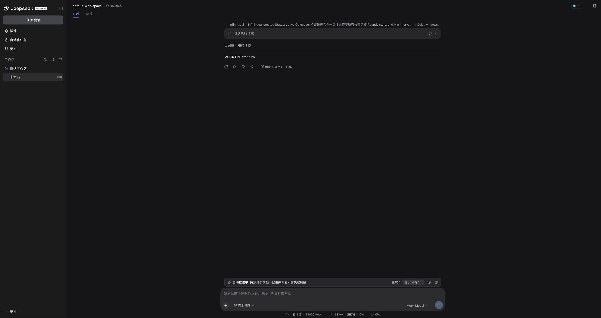
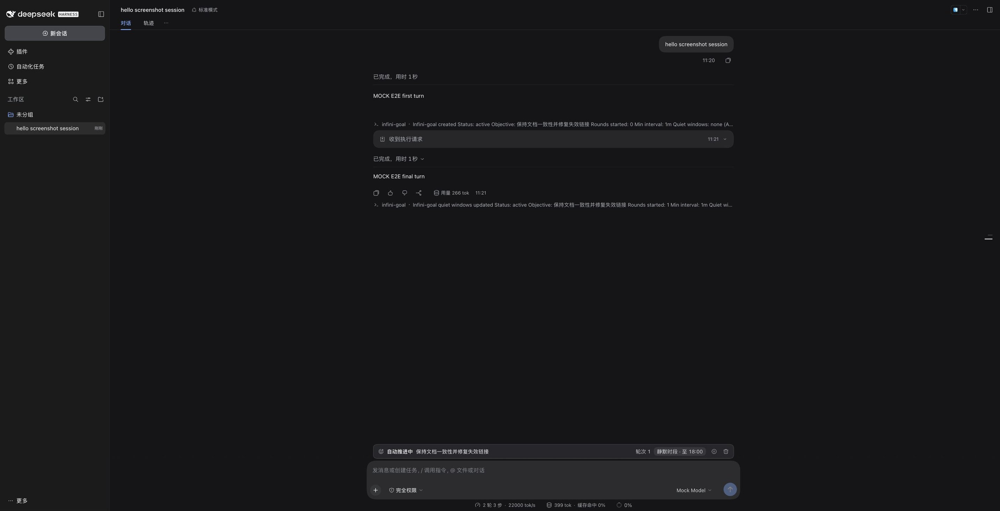

# dsh-infini-goal

[English](https://github.com/yankeguo/dsh-infini-goal/blob/main/README.md) | 简体中文

一套面向 [DeepSeek Harness](https://github.com/deepseek-ai/deepseek-harness)（DSH）的插件：
把"自动续跑"改造成一个**无限目标**——目标**没有轮次上限**，按**最小触发间隔**推进，并可用
**静默时段**在指定的本地时间段内暂停自动触发（免打扰、专注时段、非工作时段、夜间等场景均可）。

- **没有最大轮次**：目标保持 `active`，直到被完成、暂停、阻塞或清除；
- **最小触发间隔**：两次自动轮次的开始时间至少相隔配置的时长（默认 1 分钟，可设 1 秒到 30 天），
  空循环不会疯狂重试；
- **静默时段**：配置的本地时间段内不自动触发；人类对话与工具调用照常工作，时段结束后自动继续；
- **默认关闭官方 goal**：安装本 bundle 会以普通 bundle 层同时关闭 DSH 自带的 `dsh-goal`，
  infini-goal 因此成为唯一的目标系统，无需再装第二个 bundle；它贡献的每一行都可以在
  Plugins 页面单独开关。

## 特性

| 能力 | 说明 |
| --- | --- |
| 无限续跑 | 无轮次上限，目标可以一直运行到被停止 |
| 最小触发间隔 | 每轮自动触发至少间隔可配置时长 |
| 静默时段 | 支持跨午夜、按 ISO 星期过滤、IANA 时区；时段内不触发自动轮次 |
| 目标持久化 | 目标跨应用重启与会话恢复保留；pause / resume / complete / block 都持久化为会话记录 |
| 模型工具 | `get_infini_goal` / `create_infini_goal` / `update_infini_goal` |
| 人类命令 | `/infini-goal`：查看状态、配置节奏、暂停/恢复，不消耗模型轮次 |
| 状态条 | composer 上方的 InfiniGoalBar：阶段、轮次、触发节奏、静默时段提示、暂停/恢复/清除 |
| 谨慎的授权 | 创建或改写目标需要人类（或 DevLead relay 委托）授权，模型无法自行决定 |
| 可共存 | 与官方 `dsh-goal` 的工具、命令、状态条互不同名；本 bundle 默认关闭官方 goal |

## 与官方 dsh-goal 的差异

| 维度 | 官方 `dsh-goal` | 本插件 |
| --- | --- | --- |
| 轮次上限 | `maxGoalRounds`（默认 256） | 无上限 |
| 触发节流 | 无，空闲立即续跑 | 最小触发间隔 + 静默时段 |
| 激活模型 | 进程内 `armed`/`disarmed`，恢复/派生后需人工 resume | 持久化 `phase`：应用重启、会话恢复后继续（可配置 `autoContinueOnStart: false`，此时启动时持久化为 paused） |
| 工具/命令 | `get_goal` / `create_goal` / `update_goal`，`/goal` | `*_infini_goal`，`/infini-goal` |
| 共存 | — | 名称互不冲突；本 bundle 默认关闭官方 goal，也可随时切回 |

## 要求

| 项 | 要求 |
| --- | --- |
| DSH | `>=0.2.2-rc.1 <0.3.0`（0.2.2 版本线）。DSH 会跳过 `engines.dsh` 不匹配的 bundle；验证矩阵见 [DSH 兼容性](https://github.com/yankeguo/dsh-infini-goal/blob/main/docs/COMPATIBILITY.md) |
| DSH 形态 | 一个 DSH profile（桌面端或 `dsh web`）；状态条只在 Web 端渲染 |
| 依赖 | 日常使用无需额外依赖：一个 npm bundle 会装齐全部 8 个套件包。无需额外 API Key，自动轮次使用 DSH 已配置的模型 |
| Node.js | 从 npm 安装不需要本机 Node。只有可选的 0.1.0 旧会话修复脚本或本地 checkout 才需要 Node.js ≥ 24.9 与 pnpm 12（见[开发与贡献](https://github.com/yankeguo/dsh-infini-goal/blob/main/docs/CONTRIBUTING.md)） |
| 权限 | 以普通 DSH bundle 安装。与其它第三方插件一样运行在 Host 进程内（安装即信任其代码），不改变 DSH 的沙箱 / 权限模式，也不提供提权入口 |

## 安装

### 从 npm 安装（推荐）

```sh
# 主 bundle：核心服务 + 驱动器 + 模型工具 + 命令 + 状态条；
# 同时默认关闭系统自带的 dsh-goal 模式
dsh plugin --profile desktop add @yankeguo/dsh-infini-goal-bundle
```

只装这一个 bundle 就够了：它内置了与独立 bundle `@yankeguo/dsh-disable-goal-bundle` 相同的
关闭层，不需要再安装伴生 bundle。也可以在 Web 端安装：**Plugins → Add plugin**，输入包名即可。

安装后在 **Plugins** 页面确认 bundle 已启用（新安装的 bundle 通常默认启用；若显示为未启用，
勾选即可），然后刷新 Web 页面。在 bundle 详情页里，它贡献的每一行（5 个 infini-goal 行与
3 个生成的 preset-filter 行）都可以单独开关——例如保留套件但隐藏状态条。关掉整个 bundle
会实时恢复官方 goal 模式。

进阶用法也可以单独安装某个插件包，并在 profile 的 `cordis.patch.yml` 里自行插入对应的 loader
row；日常使用推荐直接装主 bundle。

安装本 bundle 会默认关闭 DSH 自带的 `dsh-goal` 模式，因此 `/goal` 与官方 goal 工具不再出现。
原理与维护方式见[关闭系统自带的 dsh-goal](https://github.com/yankeguo/dsh-infini-goal/blob/main/docs/DISABLE-BUILTIN-GOAL.md)。

### 升级

```sh
# 需要升级时显式指定版本
dsh plugin --profile desktop add @yankeguo/dsh-infini-goal-bundle@<version>
```

每个版本的更新说明见 [docs/releases](https://github.com/yankeguo/dsh-infini-goal/tree/main/docs/releases)
与 [GitHub Releases](https://github.com/yankeguo/dsh-infini-goal/releases)。

### 卸载

```sh
# DSH 下次加载 profile 时会清理已移除 bundle 的选择
dsh plugin --profile desktop remove @yankeguo/dsh-infini-goal-bundle

# 仅当单独安装过伴生 bundle 时才需要
dsh plugin --profile desktop remove @yankeguo/dsh-disable-goal-bundle
```

### 伴生 bundle

`@yankeguo/dsh-disable-goal-bundle` 供「只想关闭官方 goal、不安装 infini-goal 套件」的 profile
使用；主 bundle 已内嵌同一层。不要在同一个 profile 里同时启用两个 bundle：它们故意共用同一批
row id，DSH 能容忍重复行且每类 filter 只挂载一次，但 Plugins 页面将无法单独开关那 3 个 filter
行——请只保留一个。

从「主 bundle 尚未内置关闭层」的旧版本升级时：如果 profile 仍选中
`@yankeguo/dsh-disable-goal-bundle`，请在 Plugins 页面停用或移除它（本地 checkout 可重跑
`pnpm install:profile`，脚本会自动取消选择）。

### 从 0.1.0 升级 / 修复旧会话

0.1.0 把目标变更写成了自定义 Session 事件。DSH 0.2.2-rc.1 的持久化读取只接受它自己词表内的
event type（或带 `ignorable` 标记的插件记录），所以**用 0.1.0 写过目标的 Session 重启后会
拒绝被解释**（报 "refusing to interpret the log — it was likely written by a newer harness"）。
当前版本改用可忽略的插件记录，但**不会自动迁移** 0.1.0 的旧日志；需要时用仓库脚本一次性修复。
修复脚本位于本仓库（不在 npm 包中），先克隆仓库并执行 `pnpm install`，然后运行：

```sh
# 先退出所有可能写这些 Session 的 DSH 实例；默认 dry-run，只打印报告
node scripts/repair-session-log.mjs --dry-run --dsh-home ~/.dsh

# 确认报告（例如 "DRY-RUN ... rewrote 7 row(s)"）后再写入
node scripts/repair-session-log.mjs --write --dsh-home ~/.dsh
```

脚本只把旧的目标变更行改写为带 `ignorable` 的插件记录，其余行与字节保持不变；写入前会在旁边
保留带时间戳的 `*.bak-repair-*` 备份；默认拒绝修复仍带 `session.lock` 的 Session（确认属主进程
已退出后可加 `--force`）；重复执行是幂等的；也可以用 `--write <session-dir|log-file>...`
只修复指定日志。该脚本要求 Node.js ≥ 24.9 且本仓库已完成 `pnpm install`。

## 使用

```
/infini-goal 修完所有 failed 的文档校验并保持 CI 绿色   # 创建目标
/infini-goal                                          # 查看状态与下一次触发时间
/infini-goal status                                   # 上一条的显式别名
/infini-goal interval 10m                             # 最小触发间隔改成 10 分钟
/infini-goal quiet "Mo-Fr 09:00-18:00"                # 示例：该时段不自动触发
/infini-goal quiet none                               # 取消静默时段
/infini-goal timezone Asia/Shanghai                   # 设置静默时段时区（system 用本机时区）
/infini-goal pause | resume | complete | clear
/infini-goal block 供应商配额耗尽                       # 标记阻塞
/infini-goal edit <新目标>
```

也可以直接让模型创建目标：当人类请求是一个长期目标时，模型会调用 `create_infini_goal`
（需要当前轮次里有直接的人类消息或合法形状的 DevLead relay prompt）。目标 `complete` 之后再执行
`/infini-goal edit <新目标>` 会创建一个新目标，而不是修改已完成的目标。命令参数支持成对引号
（如 `/infini-goal quiet "Mo-Fr 09:00-18:00"` 中的引号会被剥掉一层，不会进入参数值）；
`interval` / `quiet` / `timezone` 在目标已 `complete` 时会被拒绝，需要先创建新目标。

## 状态条

状态条固定在 composer 上方，与官方 goal 的 GoalBar 同槽位：

| 自动推进中（显示轮次与节奏） | 静默时段（不自动触发） |
| --- | --- |
|  |  |

| 目标状态 | 状态条显示 | 按钮 |
| --- | --- | --- |
| `active`，距上一轮已满最小间隔 | 自动推进中 · objective · 轮次 N · `下一轮 mm:ss`（每秒刷新） | 暂停 / 清除 |
| `active`，最小间隔尚未到 | 自动推进中 · objective · 轮次 N · `最小间隔 1m` | 暂停 / 清除 |
| `active`，当前处于静默时段 | 自动推进中 · objective · 轮次 N · `静默时段 · 至 HH:mm` | 暂停 / 清除 |
| `paused` / `blocked` | 已暂停 / 已阻塞（blocked 附原因）· 轮次 N，不显示节奏行 | 恢复 / 清除 |
| `complete` 或无目标 | 不渲染 | — |

按钮只发送 `/infini-goal ...` 命令，不引入自定义 Remote API；命令错误会内联显示在状态条中。

## 配置

部署级配置写在加载该插件的 profile patch 行里。bundle 已经给出默认值；要改就在 profile 的
`cordis.patch.yml` 里按 loader row id 覆盖 `config`，注意 DSH 的 patch 对该行 config 是整体替换。

### 部署默认值（核心服务）

```yaml
- id: infini-goal
  name: '@yankeguo/dsh-infini-goal'
  config:
    defaultMinIntervalMs: 60000        # 默认最小触发间隔
    defaultQuietWindows: []            # 默认静默时段，元素 { days: [1..7], start: 'HH:mm', end: 'HH:mm' 或 '24:00' }
    # timezone: Asia/Shanghai          # 可选覆盖；默认取宿主系统时区
```

| 键 | 默认 | 范围 / 说明 |
| --- | --- | --- |
| `defaultMinIntervalMs` | `60000` | `1000` ~ `2592000000`（1s ~ 30d），整数毫秒 |
| `defaultQuietWindows` | `[]` | 每个元素 `{ days, start, end }`；创建时校验语法与可调度性 |
| `timezone` | 宿主系统时区 | IANA 名称，缺省取 `Intl` 解析的系统时区 |

### 驱动器

```yaml
- id: infini-goal-driver
  name: '@yankeguo/dsh-infini-goal-driver'
  config:
    autoContinueOnStart: true          # 插件加载 / Agent 创建时是否自动继续 active 目标
    pollFloorMs: 1000                  # agent 暂不空闲 / 有竞争输入时的安全轮询间隔
```

| 键 | 默认 | 说明 |
| --- | --- | --- |
| `autoContinueOnStart` | `true` | `false` 时，启动时把已有 `active` 目标**持久化 pause**（写入 pause 事件），等待人类 `/infini-goal resume` |
| `pollFloorMs` | `1000` | 整数，最小 `100`；agent 暂时不可驱动时的重试间隔 |

### 模型工具策略

```yaml
- id: infini-goal-tool
  name: '@yankeguo/dsh-tool-infini-goal'
  config:
    blockedAfterConsecutiveRounds: 3   # 自动轮次中，模型报告 blocked 前的最少轮次
```

| 键 | 默认 | 说明 |
| --- | --- | --- |
| `blockedAfterConsecutiveRounds` | `3` | 正整数；只在目标自己的自动轮次报告 `blocked` 时生效——人类 / DevLead relay 授权不受此限 |

bundle 里的工具行没有显式写这项配置，等价于使用默认值 `3`。

### 目标级覆盖

`create_infini_goal` / `/infini-goal interval` / `/infini-goal quiet` / `/infini-goal timezone`
写入的是每个目标自己的持久化设置，优先于部署默认值；`/infini-goal` 状态与状态条展示的也是
目标级设置。

### 时长与静默时段语法

- **时长**：`500ms`、`90s`、`5m`、`1h30m`、`2d`，可组合；作为最小触发间隔时必须在
  `1s` ~ `30d` 之间。
- **静默时段**：分号分隔多条，每条 `[days ]HH:mm-HH:mm`，例如
  `Mo-Fr 09:00-18:00; Sa-Su 10:00-12:00; 22:00-06:00`。
  - `days` 为空 = 每天；ISO 星期 1=周一 … 7=周日，支持 `Mo-Fr`、`Sa,Su`、`1-5`；
    `daily` / `everyday` / `*` 等价于每天；
  - 窗口的 `start` 含、`end` 不含；`end < start` 表示跨午夜（如 `22:00-06:00`），
    `start == end` 会被拒绝。`end` 可以写 `24:00`，表示开始日的结束（即次日 00:00），
    而 `start` 仍限制在 `00:00-23:59`；历史配置里的 `end=23:59` 会归一化为 `24:00`（如
    `Fr 18:00-23:59; Sa 00:00-23:59` 归一化为 `Fr 18:00-24:00; Sa 00:00-24:00`），
    否则 end 不含会在 23:59 留出一分钟空洞。`00:00-24:00` 是显式的全天形式；
  - `days` 过滤的是窗口**开始日**，例如 `Sa-Su 22:00-06:00` 覆盖周六 22:00→周日 06:00
    与周日 22:00→周一 06:00；
  - 多条窗口取并集；时区由 `timezone` 决定，跨夏令时按本地墙钟时间推进；
  - `none` / `off` / 空文本表示没有静默时段；`always` / `all` 会被拒绝；
  - 若静默时段覆盖全部本地时间（永远无法触发自动轮次），配置会被拒绝。

## 行为

- **节奏**：`nextAt = max(now, lastRoundAt + minIntervalMs)`（首轮不受间隔限制，创建后按
  agent 空闲与静默时段尽快触发）；若落在静默时段内，则推进到该时段结束（可连续推进），
  直到不落在任何静默时段。状态条的倒计时在本地计算，允许秒级显示偏差；实际是否触发由驱动器
  用同一份调度规则计算。
- **空循环**：每轮都是一次正常 turn；轮次间隔由最小触发间隔保证，不会出现"秒回秒触发"。
- **人类优先**：人类消息、其它工具调用照常进行；有竞争输入时驱动器会让路，等 agent 空闲
  且节奏满足后再注入下一轮。
- **静默时间只限制自动触发**：`/infini-goal` 状态、人类对话、工具调用不受影响。
- **持久化**：每轮自动触发前会把目标进度写入磁盘，保证重启或会话恢复后从最新的历史继续；
  目标在重启或会话恢复后继续，除非设置了 `autoContinueOnStart: false`。

### 自动轮次失败

自动轮次失败会 `block` 目标，`blockedReason.code` 如下：

| code | 触发条件 |
| --- | --- |
| `max-tokens` | 自动轮次达到输出 token 上限 |
| `turn-error` | turn 以 error 结束 |
| `agent-error` | 自动轮次期间 agent 报错 |
| `queue-failed` | round 消息无法入队 |
| `driver-error` | 驱动器内部异常 |
| `prompt-rejected` | round 消息在进入 step 前被下游 hook 拒绝 |
| `checkpoint-failed` | 注入下一轮前 flush Session 日志失败（durability checkpoint） |

`agent-error` 通常是失败轮次实际记录到的 code（`agent/error` 先于 `turn/end` 到达，两者都属于
该轮次自己的 turn）。人类 / hook 打断或取消**该轮次自己的 turn** 会改为 `pause`；Host 命令侧
pause / complete / block / clear 只 abort 正在运行的自动轮次，不影响人类 turn。blocked 目标
`/infini-goal resume` 后 `blockedReason` 清除。

## 已知限制

- **单目标**：每个 Session 同时只有一个 infini-goal。
- **恢复即续跑**：`active` 是持久化状态，DSH 重启或会话恢复后会继续；`autoContinueOnStart: false`
  时驱动器在启动 / Agent 创建时把 active 目标持久化为 paused，需要人类 `/infini-goal resume`。
- **fork 也会续跑**：fork 出的子会话包含目标历史，默认继续推进；不需要时先 `pause` 再 fork。
- **消耗模型轮次**：每个自动轮次都是一次正常 turn，长期运行的目标会消耗模型 token；用最小间隔、
  静默时段和暂停来控制消耗。
- **倒计时是本地计算**：状态条按当前目标状态在本地每秒计算倒计时，允许秒级显示偏差。
- **兼容性**：插件 / bundle 包声明 `engines.dsh: >=0.2.2-rc.1 <0.3.0`；DSH 升级到 0.3 前需要
  更新插件。见 [DSH 兼容性](https://github.com/yankeguo/dsh-infini-goal/blob/main/docs/COMPATIBILITY.md)。
- **单 Session 语义**：目标与轮次属于当前 Session；不提供跨 Session 共享或汇总目标。

## 授权与安全

目标变更来自人类、"当前目标的自动轮次"，或显式的 DevLead relay 信任例外；模型无法仅凭自己的
判断创建或改写目标：

- **人类**：`/infini-goal ...` 命令可以创建、编辑、暂停、恢复、完成、阻塞、清除目标，以及用
  `interval` / `quiet` / `timezone` 配置节奏。
- **模型工具**：`create_infini_goal`，以及 `update_infini_goal` 的 `edit` / `config` / `resume`，
  需要当前轮次中存在直接人类消息或合法形状的 DevLead relay prompt。`pause` / `complete` /
  `blocked` 还允许由当前目标自己的自动轮次授权（pause 只停止自主续跑）；在自动轮次中报告
  `blocked` 还要求达到 `blockedAfterConsecutiveRounds`（默认 3）。
- **非人类授权来源**：DevLead notice、定时任务提示、subagent 消息、agent-team 消息、其他 agent
  消息和运行期通知永不授权目标变更。
- **UI**：状态条按钮只提交 `/infini-goal ...` 命令，没有独立 Remote API 或更高权限。
- **安全边界**：插件运行在 Host 进程内，安装第三方插件等同于信任其代码；本套件不改变 DSH 的
  沙箱 / 权限模式，也不额外提供任何提权入口。

relay 的精确形状、fail-closed 规则与完整授权模型见[设计说明](https://github.com/yankeguo/dsh-infini-goal/blob/main/docs/DESIGN.md)。

## 故障排查 / FAQ

| 现象 | 可能原因 / 处理 |
| --- | --- |
| 安装后没有状态条 | bundle 未启用（在 Plugins 页面勾选）或页面未刷新 |
| 没有 `/infini-goal` 命令或 `*_infini_goal` 工具 | bundle 未启用 / 被 DSH 跳过（检查 DSH 版本与 `engines.dsh`） |
| 目标不自动续跑 | 相态不是 `active`；命中静默时段或最小间隔未到；`autoContinueOnStart: false` 下被持久 pause；agent 正忙或有竞争输入 |
| `/infini-goal quiet ...` 报"覆盖全天"类错误 | 静默时段并集覆盖了全部本地时间，会永久阻止自动轮次；改为部分时段或 `none` |
| 状态条显示 paused 但没有自动恢复 | 这是 `autoContinueOnStart: false` 的预期行为；执行 `/infini-goal resume` |
| fork 后目标继续跑 | 预期行为；fork 前先 `/infini-goal pause` |
| 重启后 Session 无法恢复，日志报 "refusing to interpret the log" | 该 Session 由 0.1.0 的旧表示写入；退出 DSH 后按上文「从 0.1.0 升级 / 修复旧会话」运行修复脚本 |
| `repair-session-log.mjs` 报 session.lock | 对应 Session 仍被 DSH 打开；退出 DSH / 关闭 Session 后重跑，或确认属主进程已退出后加 `--force` |
| 仍看到 `/goal` | 本 bundle 默认关闭官方 goal，但 preset 变更只影响新 Agent；重启一次 DSH 并新建会话。若在 Plugins 页面停用了该 bundle 或它的 preset-filter 行，请重新启用 |
| 想恢复官方 goal 模式 | 在 Plugins 页面停用（或移除）`@yankeguo/dsh-infini-goal-bundle`，官方 goal 会实时恢复 |
| 无限目标会消耗模型 token 吗？ | 会：每个自动轮次都是一次正常模型 turn；可用最小间隔 / 静默时段调节，或不需要时暂停目标 |

## 文档

- [设计说明](https://github.com/yankeguo/dsh-infini-goal/blob/main/docs/DESIGN.md)：领域模型、
  持久化、驱动器、授权与 UI 设计
- [DSH 兼容性](https://github.com/yankeguo/dsh-infini-goal/blob/main/docs/COMPATIBILITY.md)：声明范围、
  验证矩阵、兼容层
- [关闭系统自带的 dsh-goal](https://github.com/yankeguo/dsh-infini-goal/blob/main/docs/DISABLE-BUILTIN-GOAL.md)：
  为什么要关闭、如何关闭
- [开发与贡献](https://github.com/yankeguo/dsh-infini-goal/blob/main/docs/CONTRIBUTING.md)：仓库结构、
  构建 / 测试命令、E2E 与插件展示元数据
- [发布指南](https://github.com/yankeguo/dsh-infini-goal/blob/main/docs/PUBLISHING.md)：staged publish 流程
- [版本说明](https://github.com/yankeguo/dsh-infini-goal/tree/main/docs/releases) 与
  [GitHub Releases](https://github.com/yankeguo/dsh-infini-goal/releases)：版本历史与 changelog
- [E2E 验证工具](https://github.com/yankeguo/dsh-infini-goal/blob/main/tools/e2e/README.md)：仅开发使用

## License

[MIT](https://github.com/yankeguo/dsh-infini-goal/blob/main/LICENSE)
